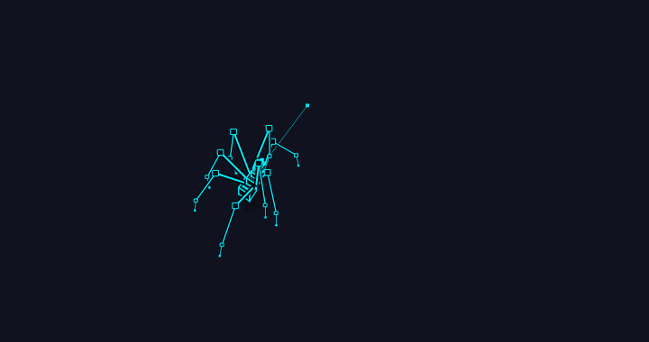
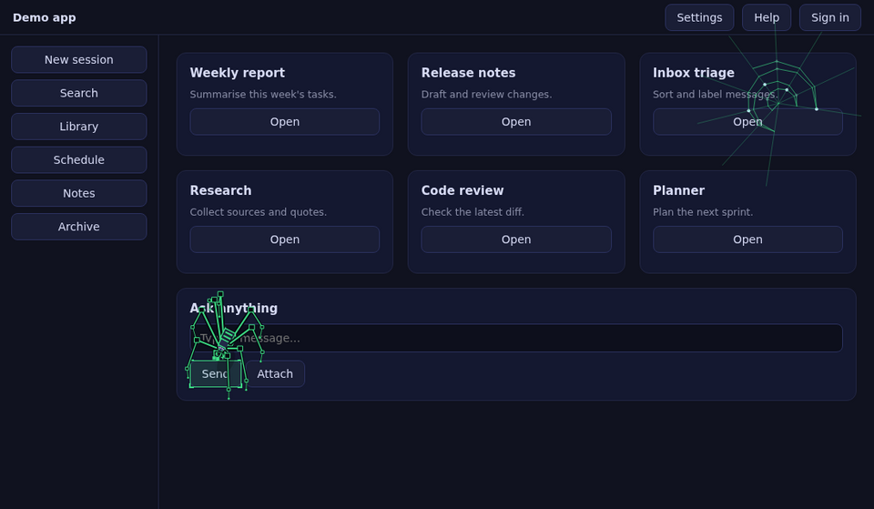
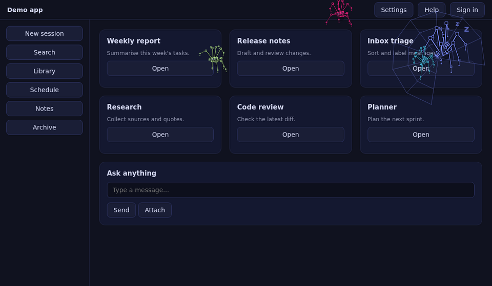
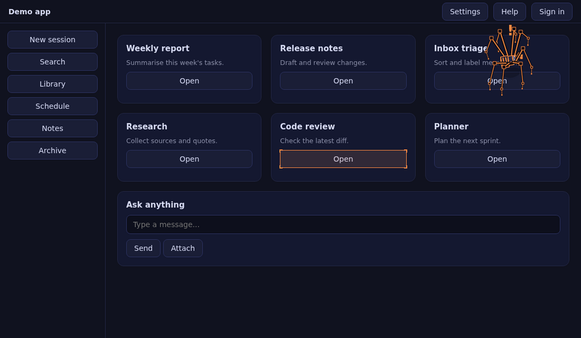

# Web Crawler Spider

[](https://github.com/mistrysiddh/web-crawler-spider/actions/workflows/ci.yml)
[](LICENSE)


A Hermes Desktop plugin: an eight-legged spider that lives on the Hermes window and reacts to what the agent
is doing. It spins a web while tools run, sends helper spiders for subagents, gets restless when Hermes waits for
you and freezes when a command looks risky.



By default it reads nothing from the app; it only listens to the events Hermes already sends it. It never
clicks, edits, hides or restyles anything, and the overlay it draws ignores the mouse, so you can always click
straight through it.

## Install

From the Hermes plugin catalog (once listed):

```bash
hermes plugins install web-crawler-spider
hermes plugins enable web-crawler-spider
```

Or by hand: copy `desktop/plugin.js` to `~/.hermes/desktop-plugins/web-crawler-spider/plugin.js`. Hermes Desktop
loads it within a few seconds. The first time, a small bubble points you to the spider icon in the status bar: click
it for the settings panel (sliders for size, speed and body, a colour picker, a switch for every feature, pause,
nap, reset and a *Demo all* button that shows every trick in half a minute).

## What it does

- **Roams its own overlay.** Long arched legs, a small box body, a real tetrapod gait, and a thin silk line to the
  spot it is heading for. Colours follow your theme. By default it reads nothing from the app.
- **Explore mode (opt-in, off by default).** Turn on *Explore the app* in the settings panel and it walks to the
  app's real buttons, links and inputs instead, boxing the one it stands on. This is the only mode that reads the
  page (see the disclosure below).
- **Work web.** While the agent works, a web grows in the corner, one strand per tool call. A finished run leaves
  dew on it, a failed run a torn web.

  
- **Helper spiders.** Every running subagent gets a small helper spider that works around the big one, turns
  green when its subagent succeeds (red when it fails) and walks off the edge.

  
- **Attention.** When Hermes waits for approval the spider turns amber and fidgets. With Explore on it also walks
  to the **Run** button and taps beside it, and on an error it goes to the error banner.
- **Spider-sense.** A risky command (`rm`, `sudo`, `git reset --hard`, `curl | sh`, …) in an approval request or
  tool call makes it freeze, stand tall with its front legs up and flash red with a "!".

  
- **Mood colours.** Amber while waiting for you, red on errors, green when a run completes.
- **Alive.** Flies show up now and then and get hunted, wrapped and eaten. It grooms, stretches, naps in a corner
  web when nothing happens, hops away when you click near it, and now and then dashes after the mouse cursor for
  a few seconds.
- **Wind.** Scrolling or moving the window sways the silk; moving the window makes the spider hug the ground.
- **Visitors.** With two Hermes windows open, their spiders visit each other and wave.
- **Light on the CPU.** When the window is hidden or minimised the spider freezes at once; if it just loses focus it
  freezes after a few seconds. No animation frames, no DOM scanning, no timers doing work, until you come back.
  On a machine so busy that frames come seconds apart it rests for a while and tries again. Switch this off in the
  settings panel if you want it to keep going.
- **Colours and cheers.** Follows your theme, or pick Ember, Moss, Ice, Violet or Rose. After a long run that ends
  well it does a little victory dance.
- It always stays fully inside the window.

## Commands (Ctrl+K → "Spider: …")

Pause / resume, Bigger, Smaller, Faster, Slower, Bigger body, Smaller body, Silk guide line on/off, Flies on/off,
Release a fly, Helper spiders on/off, Work web on/off, Attention + spider-sense on/off, Wind on/off, Explore the app on/off, Next colour, Visiting
between windows on/off, Cursor chase on/off, Freeze in the background on/off, Take a nap, Wake up, Reset size, speed and extras.

Demos (no real work needed): Show everything, Show a helper spider, Show the work web, Test spider-sense, Show a visiting spider,
Send my spider to visit another window, Chase my cursor now.

Everything in the settings panel is also available from the palette. Settings are saved in the plugin's own storage and survive restarts.

## What it touches (disclosure)

- **By default it does not read the app's elements.** It reads only the theme: CSS variables and background colour
  of the root and `<body>` via `getComputedStyle`. No `querySelectorAll`, no `elementFromPoint`, no button text.
- **Only if you turn on Explore the app** (off by default) it reads the page with `document.querySelectorAll`,
  `elementFromPoint` and `getComputedStyle` to find buttons, links, inputs and alert banners, and to find the
  approval button by its label. Nothing is modified, clicked or hidden.
- **Listens** (capture, passive) to pointer, keyboard, wheel and scroll events, and to window focus / visibility changes, only to react to them. Nothing is
  recorded or sent anywhere.
- **Subscribes to Hermes gateway events** through `ctx.onEvent` (message, tool, approval, error and subagent
  events) to pick moods and helpers. It reads event types and, to spot risky commands, the text of tool and
  approval payloads. That text is matched in memory and thrown away.
- **Talks to its own other windows** over a same-origin `BroadcastChannel` (`web-crawler-spider/peers`) with tiny
  position-free messages ("hello", "visit", "back", "gone").
- **No network calls, no shell commands, no background processes, no credentials, no telemetry.** It never
  updates itself. Only `@hermes/plugin-sdk` and `react` are imported.
- It draws on one full-window canvas (`pointer-events: none`, `data-wcs` attribute) plus one outline `div`, and
  removes both when it is disabled.

## Develop

Hermes loads one file, `desktop/plugin.js`, but it is built from the pieces in `src/` (config, events, geometry,
the spider itself, settings, the panel, the plugin entry) by a tiny script with no dependencies. Edit `src/`,
then build. The built file is committed, because that is what the catalog pins.

```bash
npm install
npm run build        # src/*.js -> desktop/plugin.js
npm test             # checks the build is current, then runs the logic test in jsdom
SEED=2 npm test      # the test uses seeded random numbers; try another seed
hermes plugins validate .
```

The test plays the plugin through a simulated clock (about 170 checks, a few minutes). To try a change in the
app, copy `desktop/plugin.js` to `~/.hermes/desktop-plugins/web-crawler-spider/plugin.js`.

## Licence

MIT, see `LICENSE`.
