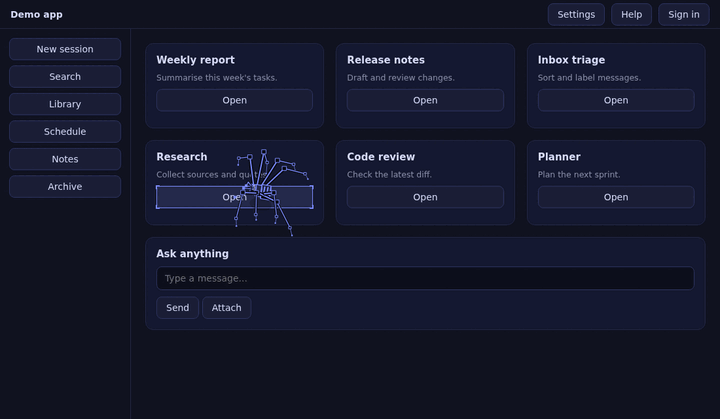

# Web Crawler Spider

A Hermes Desktop plugin: an eight-legged spider that literally crawls the Hermes window. It walks between the
real buttons, links and inputs, outlines the one it is standing on, and reacts to what the agent is doing.



It only reads the page. It never clicks, edits, hides or restyles anything, and the overlay it draws ignores
the mouse, so you can always click straight through it.

## Install

From the Hermes plugin catalog (once listed):

```bash
hermes plugins install web-crawler-spider
hermes plugins enable web-crawler-spider
```

Or by hand: copy `desktop/plugin.js` to `~/.hermes/desktop-plugins/web-crawler-spider/plugin.js`. Hermes Desktop
loads it within a few seconds. The 🕷 chip in the status bar pauses and resumes it.

## What it does

- **Crawls the UI.** Long arched legs, a small box body, a real tetrapod gait, and a thin silk line to the box it
  is heading for. Colours follow your theme.
- **Work web.** While the agent works, a web grows in the corner, one strand per tool call. A finished run leaves
  dew on it, a failed run a torn web.

  
- **Helper spiders.** Every running subagent gets a small helper spider that works around the big one, turns
  green when its subagent succeeds (red when it fails) and walks off the edge.

  
- **Attention.** When Hermes waits for approval the spider walks to the **Run** button and taps beside it. On an
  error it goes to the error banner.
- **Spider-sense.** A risky command (`rm`, `sudo`, `git reset --hard`, `curl | sh`, …) in an approval request or
  tool call makes it freeze, stand tall with its front legs up and flash red with a "!".

  
- **Mood colours.** Amber while waiting for you, red on errors, green when a run completes.
- **Alive.** Flies show up now and then and get hunted, wrapped and eaten. It grooms, stretches, naps in a corner
  web when nothing happens, hops away when you click near it, and now and then dashes after the mouse cursor for
  a few seconds.
- **Wind.** Scrolling or moving the window sways the silk; moving the window makes the spider hug the ground.
- **Visitors.** With two Hermes windows open, their spiders visit each other and wave.
- It always stays fully inside the window.

## Commands (Ctrl+K → "Spider: …")

Pause / resume, Bigger, Smaller, Faster, Slower, Bigger body, Smaller body, Silk guide line on/off, Flies on/off,
Release a fly, Helper spiders on/off, Work web on/off, Attention + spider-sense on/off, Wind on/off, Visiting
between windows on/off, Cursor chase on/off, Take a nap, Wake up, Reset size, speed and extras.

Demos (no real work needed): Show a helper spider, Show the work web, Test spider-sense, Show a visiting spider,
Send my spider to visit another window, Chase my cursor now.

Settings are saved in the plugin's own storage and survive restarts.

## What it touches (disclosure)

- **Reads the page** with `document.querySelectorAll`, `elementFromPoint` and `getComputedStyle` to find buttons,
  links, inputs and alert banners, and the theme colour. Nothing is modified, clicked or hidden.
- **Listens** (capture, passive) to pointer, keyboard, wheel and scroll events only to react to them. Nothing is
  recorded or sent anywhere.
- **Subscribes to Hermes gateway events** through `ctx.onEvent` (message, tool, approval, error and subagent
  events) to pick moods and helpers. It reads event types and, to spot risky commands, the text of tool and
  approval payloads. That text is matched in memory and thrown away.
- **Talks to its own other windows** over a same-origin `BroadcastChannel` (`web-crawler-spider/peers`) with tiny
  position-free messages ("hello", "visit", "back", "gone").
- **No network calls, no shell commands, no background processes, no credentials, no telemetry.** It never
  updates itself. Only `@hermes/plugin-sdk` and `react` are imported.
- It draws on one full-window canvas (`pointer-events: none`, `data-wcs` attribute) plus one outline `div`, and
  removes both when it is disabled.

## Develop

`desktop/plugin.js` is a single ES module with no build step. The logic test runs the plugin in jsdom with a
simulated clock (about 100 checks, a few minutes):

```bash
npm install
npm test
hermes plugins validate .
```

## Licence

MIT, see `LICENSE`.
